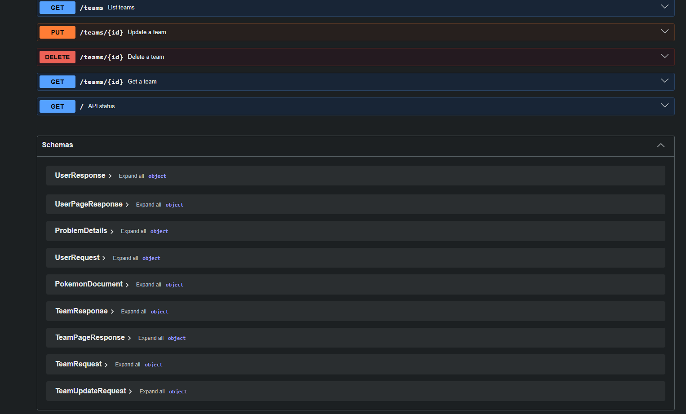

# PokeHelper

Projeto de Web 2.

Equipe:

- Adriano Nobrega Azevedo Filho - 20250070190
- Antonio Higino Bisneto Leite Medeiros - 20250070261
- Gabriel Guilherme Cavalcanti da Costa - 20200042966

Como rodar:

1. Clone o repositório
2. Instale o Docker com Docker Compose e, para execução local, Java 21 e `mise`
3. Para subir a API e o PostgreSQL:
   ```bash
   docker compose up --build
   ```
   Ou use `mise run up`. A API fica em `http://localhost:8080`. O PostgreSQL usa a porta `5432` por padrão, ou `POSTGRES_HOST_PORT` quando definida no `.env` (por exemplo, `5433`).
4. Para encerrar os serviços, execute `docker compose down`.

As configurações do banco podem ser sobrescritas pelas variáveis `POSTGRES_DB`, `POSTGRES_USER`, `POSTGRES_PASSWORD` e `POSTGRES_HOST_PORT` (porta publicada no host). Os valores padrão são destinados apenas ao desenvolvimento local. O Flyway aplica as migrações de `com/PokeHelper/src/api/resources/db/migration` quando a API inicia.

O código do serviço Ktor fica em `com/PokeHelper/src/api/`. As pastas `com/PokeHelper/src/services/` e `com/PokeHelper/src/protos/` ficam reservadas, respectivamente, ao microsserviço Go e aos contratos compartilhados entre serviços.

## API de usuários

| Método | Rota | Resultado |
| --- | --- | --- |
| `GET` | `/users?page=1&size=20&username=nome` | Lista usuários; `username` é um filtro exato opcional. A resposta inclui `items`, `page`, `size` e `total`. `size` aceita de 1 a 100. |
| `GET` | `/users/{id}` | Busca um usuário por ID. |
| `POST` | `/users` | Cria um usuário; retorna `201` e o cabeçalho `Location`. |
| `PUT` | `/users/{id}` | Substitui nome e senha do usuário. |
| `DELETE` | `/users/{id}` | Remove o usuário e retorna `204`. |
| `GET` | `/users/{id}/teams` | Lista os times associados ao usuário. |

`POST` e `PUT` recebem JSON com `username` e `password`, ambos obrigatórios. As respostas de usuário contêm apenas `id` e `username`; a senha não é devolvida. IDs inexistentes retornam `404`, nomes duplicados retornam `409` e entradas inválidas retornam `400`.

Exemplo no PowerShell:

```powershell
Invoke-RestMethod http://localhost:8080/users -Method Post -ContentType 'application/json' -Body '{"username":"ash","password":"senha-exemplo"}'
Invoke-RestMethod 'http://localhost:8080/users?page=1&size=20&username=ash'
```

## API de times

| Método | Rota | Resultado |
| --- | --- | --- |
| `GET` | `/teams?page=1&size=20&name=time&userId=1` | Lista times, com filtros exatos opcionais por `name` e `userId`. A resposta inclui `items`, `page`, `size` e `total`; `size` aceita de 1 a 100. |
| `GET` | `/teams/{id}` | Busca um time por ID. |
| `POST` | `/teams` | Cria um time; retorna `201` e o cabeçalho `Location`. |
| `PUT` | `/teams/{id}` | Atualiza o nome e os Pokémon do time. |
| `DELETE` | `/teams/{id}` | Remove um time e retorna `204`. |
| `GET` | `/users/{id}/teams` | Lista os times associados ao usuário. |

Um time possui `name`, `userId` e `pokemons`. `pokemons` deve conter de 1 a 6 objetos da PokéAPI, cada um com `id` inteiro positivo e `name`; IDs repetidos não são aceitos. Os objetos são preservados na resposta, de modo que campos adicionais retornados pela PokéAPI (como `types` e `sprites`) podem ser enviados e recuperados junto do time.

Exemplo de criação:

```powershell
Invoke-RestMethod http://localhost:8080/teams -Method Post -ContentType 'application/json' -Body '{"name":"Time de Kanto","userId":1,"pokemons":[{"id":25,"name":"pikachu","types":[{"slot":1,"type":{"name":"electric"}}]}]}'
```

Para executar os testes, use `mise run test`; essa tarefa inicia o PostgreSQL em segundo plano antes de chamar o Gradle.

## Documentação interativa da API

Com a API em execução em `http://localhost:8080`:

- Swagger UI: http://localhost:8080/swagger
- Especificação OpenAPI (JSON): http://localhost:8080/swagger/openapi.json

A especificação é gerada das rotas e das descrições `describe` do Ktor quando a aplicação inicia. Ela inclui os parâmetros, corpos, respostas e erros em `application/problem+json`. A Swagger UI usa os arquivos do Swagger hospedados no unpkg, portanto o navegador precisa de acesso à internet para carregar a interface.


## Vídeos

- Sprint 0: https://youtu.be/wUd9-fjZmRQ
- Sprint 1: https://youtu.be/u50RZ6qEORU