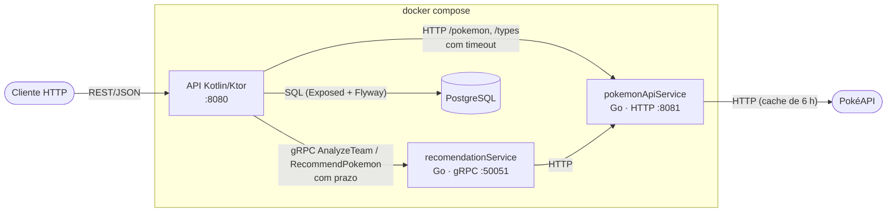
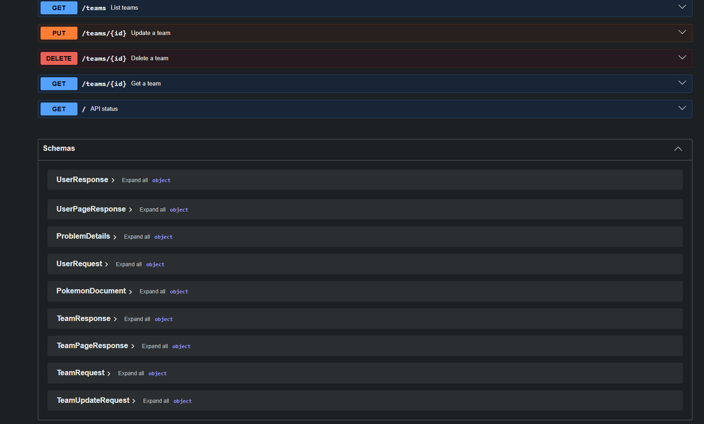

# PokeHelper

Projeto de Web 2 (DIM0547).

Equipe:

- Adriano Nobrega Azevedo Filho - 20250070190
- Antonio Higino Bisneto Leite Medeiros - 20250070261
- Gabriel Guilherme Cavalcanti da Costa - 20200042966

## O que é

Montar um time Pokémon equilibrado obriga o jogador a pesquisar tipos, fraquezas e resistências em várias fontes, ou a planejar tudo de cabeça. Com isso, lacunas defensivas do time passam despercebidas.

O **PokeHelper** é um backend que ajuda a planejar times. O jogador cria uma conta, monta e salva times de até seis Pokémon (no formato da PokéAPI) e pede uma **análise defensiva**: como o time recebe cada tipo de ataque e que tipos equilibrariam a composição. Depois, pode pedir **sugestões de Pokémon** de um tipo que complementam o time.

A API principal (Kotlin/Ktor) cuida de usuários, times e persistência. A análise e a recomendação ficam num **serviço Go** separado, chamado por **gRPC**. Um segundo serviço Go mantém um cache da PokéAPI, usado pela recomendação e pelas rotas `/pokemon` da API. A API continua funcionando quando esses serviços estão fora do ar: só as rotas que dependem deles respondem `503`.

## Arquitetura



| Pasta | Conteúdo |
| --- | --- |
| `api/` | Serviço principal em Kotlin/Ktor: domínio, casos de uso e adapters (HTTP, PostgreSQL, gRPC). |
| `protos/` | Contratos Protocol Buffers compartilhados (`pokehelper.recommendation.v1`), com `buf.yaml` e `buf.gen.yaml`. |
| `recomendationService/` | Serviço Go de análise defensiva e recomendação de Pokémon (gRPC). |
| `pokemonApiService/` | Serviço Go de catálogo: cache da PokéAPI (HTTP). |
| `docs/` | Proposta do projeto. |

Na API, `domain` e `usecases` não conhecem Ktor, banco, JSON nem gRPC. Essas dependências ficam nos `adapters`, e um teste de arquitetura (Konsist) garante a regra. O serviço de recomendação é acessado pela porta `TeamRecommender` (`adapters/grpc/GrpcTeamRecommender`) e o catálogo pela porta `PokemonCatalog` (`adapters/catalog/HttpPokemonCatalog`).

## Pré-requisitos

| Para | Precisa de |
| --- | --- |
| Rodar o sistema | Docker 24+ com Docker Compose v2 |
| Rodar os testes da API | Java 21 e Docker (usado pelo Testcontainers) |
| Rodar os testes Go | Go (versão do `go.mod` de cada serviço) |
| Validar os contratos | [`buf`](https://buf.build/docs/installation) 1.x |

## Como rodar

```bash
git clone https://github.com/antonio-higino/PokeHelper.git
cd PokeHelper
docker compose up --build
```

Para subir também os serviços Go, use o profile `go`:

```bash
docker compose --profile go up --build
```

Ao final, `docker compose --profile go ps` mostra `poke_helper_db`, `poke_helper_catalog`, `poke_helper_recommendation` e `poke_helper` como `healthy`. A API espera os serviços Go ficarem saudáveis antes de subir. Sem o profile, sobem só o banco e a API. A API fica em <http://localhost:8080> e as migrações do Flyway são aplicadas na subida. Para encerrar, use `docker compose --profile go down`, ou acrescente `-v` para apagar também os dados.

### Variáveis de ambiente

Todas são opcionais localmente. Para mudar algum valor, crie um `.env` na raiz com `NOME=valor`.

| Variável | Padrão | Uso |
| --- | --- | --- |
| `POSTGRES_DB`, `POSTGRES_USER`, `POSTGRES_PASSWORD` | `app_db`, `admin`, `admin` | Banco do compose (apenas desenvolvimento) |
| `POSTGRES_HOST_PORT`, `API_HOST_PORT` | `5432`, `8080` | Portas publicadas no host |
| `DATABASE_URL`, `DATABASE_USER`, `DATABASE_PASSWORD` | banco local | Conexão JDBC da API |
| `RECOMMENDATION_TARGET` | `recommendation:50051` no compose | Endereço gRPC do serviço de recomendação; vazio desativa a integração |
| `RECOMMENDATION_TIMEOUT_MS` | `15000` | Prazo de cada chamada gRPC |
| `POKEMON_API_SERVICE_URL` | `http://pokemon-api:8081` no compose | URL do serviço de catálogo; vazio desativa as rotas `/pokemon` |
| `POKEMON_API_TIMEOUT_MS` | `10000` | Timeout de cada chamada ao catálogo |
| `PORT` | `8080` | Porta HTTP da API |

## Como testar

```bash
cd api && ./gradlew test            # requer Docker para o Testcontainers
cd protos && buf lint
cd recomendationService && go test ./...
cd pokemonApiService && go test ./...
```

A suíte da API não precisa de nenhuma configuração: o Testcontainers sobe um PostgreSQL descartável.

| Suíte | Cobre |
| --- | --- |
| `usecases/*Test` | Unitários dos casos de uso com repositórios e portas falsas |
| `PostgresRepositoriesTest`, `ApiIntegrationTest` | Integração com PostgreSQL real: CRUD, relacionamento usuário→times, paginação e a aplicação inteira (`module()`) sem o serviço Go |
| `adapters/GrpcTeamRecommenderTest` | Cliente gRPC contra um servidor gRPC em memória: prazo e tradução de `UNAVAILABLE` e `INVALID_ARGUMENT` |
| `RecommendationFlowTest` | Fluxo HTTP → API → gRPC com o serviço no ar (200) e fora do ar (503, a API continua de pé) |
| `ArchitectureTest` | Konsist: falha se `domain` ou `usecases` importarem Ktor, gRPC, Exposed, Flyway, JDBC, Jackson ou adapters |

O [CI](.github/workflows/ci.yml) roda em todo push e PR. Ele executa:

- `buf lint`;
- a suíte da API;
- `go test` dos serviços Go.

## Exemplos

```bash
# Criar usuário -> 201, Location: /users/1
curl -s -X POST localhost:8080/users -H 'Content-Type: application/json' \
  -d '{"username":"ash","password":"pikachu"}'
# {"id":1,"username":"ash"}

# Criar time -> 201, Location: /teams/1
curl -s -X POST localhost:8080/teams -H 'Content-Type: application/json' \
  -d '{"name":"Kanto","userId":1,"pokemons":[{"id":6,"name":"charizard","types":[{"slot":1,"type":{"name":"fire"}},{"slot":2,"type":{"name":"flying"}}]}]}'
# {"id":1,"name":"Kanto","userId":1,"pokemons":[{"id":6,"name":"charizard","types":[...]}]}

# Análise defensiva (serviço Go no ar) -> 200
curl -s localhost:8080/teams/1/analysis
# {"teamId":1,"coverage":[{"attackingType":"rock","immune":0,"veryResistant":0,"resistant":0,"neutral":0,"weak":0,"veryWeak":1},...],
#  "recommendedTypes":[{"type":"water","score":6},...]}

# Pokémon sugeridos de um tipo -> 200
curl -s 'localhost:8080/teams/1/recommendations?type=water'
# {"teamId":1,"type":"water","candidates":[{"id":9,"name":"blastoise","types":["water"],"baseStatTotal":530,
#  "combinationRank":0,"spriteUrl":"https://..."},...]}

# Serviço Go fora do ar -> 503 em poucos milissegundos
# {"type":"about:blank","title":"Service Unavailable","status":503,"detail":"The recommendation service is unavailable"}

# Prontidão (verifica só o banco)
curl -s localhost:8080/health/ready
# {"status":"UP"}
```

## Documentação interativa (OpenAPI)

Com a API rodando:

- Swagger UI: <http://localhost:8080/swagger>
- Especificação OpenAPI (JSON): <http://localhost:8080/swagger/openapi.json>



A especificação é gerada das rotas e das descrições `describe` do Ktor. Ela inclui parâmetros, corpos, respostas e erros.

## Licença

[MIT](LICENSE).

## Vídeo

- Sprint 2: _a preencher_
