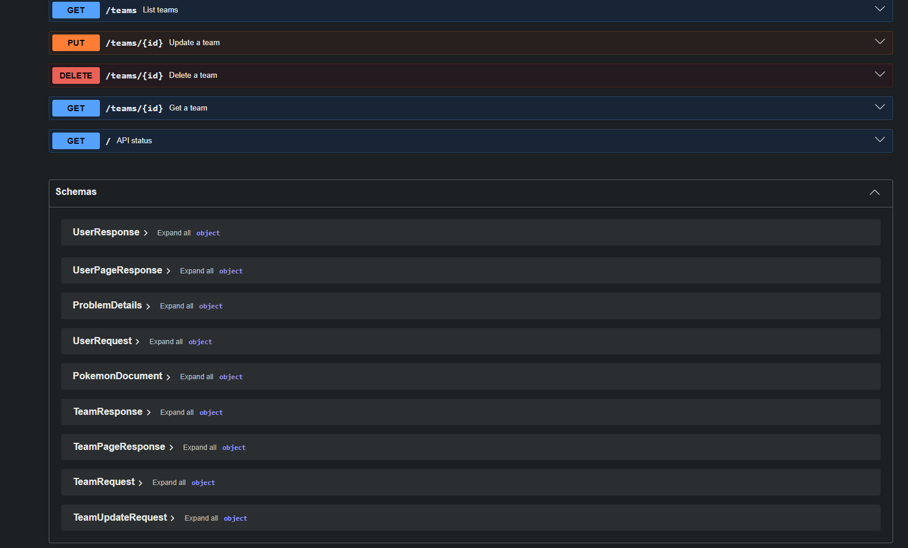

# PokeHelper

Projeto de Web 2.

Equipe:

- Adriano Nobrega Azevedo Filho - 20250070190
- Antonio Higino Bisneto Leite Medeiros - 20250070261
- Gabriel Guilherme Cavalcanti da Costa - 20200042966

Como rodar:

1. Clone o repositório
2. Instale o Docker com Docker Compose e, para execução local, Java 21 e `mise`
3. Para subir a API, o PostgreSQL e os microsserviços Go:
   ```bash
   docker compose up --build
   ```
   Ou use `mise run up`. A API fica em `http://localhost:8080`. O PostgreSQL usa a porta `5432` por padrão, ou `POSTGRES_HOST_PORT` quando definida no `.env` (por exemplo, `5433`).
4. Para encerrar os serviços, execute `docker compose down`.

O Compose também inicia `pokemon-api` (HTTP `8081`, gRPC `50051`) e `recommendation` (HTTP `8082`, gRPC `50052`). A API Kotlin conversa com ambos por gRPC; o frontend usa a API HTTP na porta `8080`. Os endpoints HTTP Go continuam disponíveis para compatibilidade e para a comunicação entre recomendação e catálogo.

As configurações do banco podem ser sobrescritas pelas variáveis `POSTGRES_DB`, `POSTGRES_USER`, `POSTGRES_PASSWORD` e `POSTGRES_HOST_PORT` (porta publicada no host). Os valores padrão são destinados apenas ao desenvolvimento local. O Flyway aplica as migrações de `com/PokeHelper/src/api/resources/db/migration` quando a API inicia.

O código Ktor fica em `com/PokeHelper/src/api/`. Os serviços Go ficam em `../pokemonApiService/` e `../recomendationService/`, os contratos em `../protos/` e os stubs Go compartilhados em `../rpc/`.

## API de usuários

| Método | Rota | Resultado |
| --- | --- | --- |
| `GET` | `/users?page=1&size=20&username=nome` | Lista usuários; `username` é um filtro exato opcional. A resposta inclui `items`, `page`, `size` e `total`. `size` aceita de 1 a 100. |
| `GET` | `/users/{id}` | Busca um usuário por ID. |
| `POST` | `/users` | Cria um usuário; retorna `201` e o cabeçalho `Location`. |
| `PUT` | `/users/{id}` | Substitui nome e senha do usuário. |
| `DELETE` | `/users/{id}` | Remove o usuário e retorna `204`. |
| `GET` | `/users/{id}/teams` | Lista os times associados ao usuário. |

`POST` e `PUT` recebem JSON com `username` e `password`, ambos obrigatórios. As respostas de usuário contêm apenas `id` e `username`; a senha não é devolvida. IDs inexistentes retornam `404`, nomes duplicados retornam `409` e entradas inválidas retornam `400`.

Exemplo no PowerShell:

```powershell
Invoke-RestMethod http://localhost:8080/users -Method Post -ContentType 'application/json' -Body '{"username":"ash","password":"senha-exemplo"}'
Invoke-RestMethod 'http://localhost:8080/users?page=1&size=20&username=ash'
```

## API de times

| Método | Rota | Resultado |
| --- | --- | --- |
| `GET` | `/teams?page=1&size=20&name=time&userId=1` | Lista times, com filtros exatos opcionais por `name` e `userId`. A resposta inclui `items`, `page`, `size` e `total`; `size` aceita de 1 a 100. |
| `GET` | `/teams/{id}` | Busca um time por ID. |
| `POST` | `/teams` | Cria um time; retorna `201` e o cabeçalho `Location`. |
| `PUT` | `/teams/{id}` | Atualiza o nome e os Pokémon do time. |
| `DELETE` | `/teams/{id}` | Remove um time e retorna `204`. |
| `GET` | `/users/{id}/teams` | Lista os times associados ao usuário. |

Um time possui `name`, `userId` e `pokemons`. `pokemons` deve conter de 1 a 6 objetos da PokéAPI, cada um com `id` inteiro positivo e `name`; IDs repetidos não são aceitos. Os objetos são preservados na resposta, de modo que campos adicionais retornados pela PokéAPI (como `types` e `sprites`) podem ser enviados e recuperados junto do time.

Exemplo de criação:

```powershell
Invoke-RestMethod http://localhost:8080/teams -Method Post -ContentType 'application/json' -Body '{"name":"Time de Kanto","userId":1,"pokemons":[{"id":25,"name":"pikachu","types":[{"slot":1,"type":{"name":"electric"}}]}]}'
```

## Catálogo e recomendações

| Método | Rota da API Kotlin | Resultado |
| --- | --- | --- |
| `GET` | `/pokemon/{name-ou-id}` | Obtém um Pokémon via o microsserviço de catálogo, que consulta e armazena em cache a resposta da PokéAPI. |
| `GET` | `/pokemon/types` | Obtém os 18 tipos e suas relações de dano do cache do catálogo. |
| `GET` | `/pokemon/types/{type}` | Obtém um tipo específico e sua lista de Pokémon. |
| `POST` | `/recommendations` | Calcula a matriz de cobertura defensiva e até cinco tipos recomendados. |
| `POST` | `/recommendations/pokemon` | Sugere Pokémon para um tipo, considerando o time informado. |

Os dois `POST` recebem `pokemons`, com os objetos completos retornados por `/pokemon/{name-ou-id}`. A rota de candidatos também recebe `type`:

```json
{
  "type": "ground",
  "pokemons": [{ "id": 25, "name": "pikachu", "types": [{ "slot": 1, "type": { "name": "electric" } }] }]
}
```

O microsserviço de recomendações consome exclusivamente o microsserviço de catálogo. Ele não consulta a PokéAPI diretamente, aplica o cálculo defensivo do projeto Web I e descarta formas Mega/Gigantamax/Totem, Pokémon lendários, míticos, bebês e os Pokémon já presentes no time.

Para executar todos os testes, use `mise run test`; essa tarefa inicia o PostgreSQL em segundo plano, executa as suítes dos dois serviços Go e então chama o Gradle.

Ao usar uma porta diferente de `5432` em `POSTGRES_HOST_PORT`, configure também `DATABASE_URL` no ambiente em que o Gradle é executado. Por exemplo, para a porta `5433`, no PowerShell: `$env:DATABASE_URL = 'jdbc:postgresql://localhost:5433/app_db'`. Ajuste também `DATABASE_USER` e `DATABASE_PASSWORD` se as credenciais do PostgreSQL forem alteradas.

## Documentação interativa da API

Com a API em execução em `http://localhost:8080`:

- Swagger UI: http://localhost:8080/swagger
- Especificação OpenAPI (JSON): http://localhost:8080/swagger/openapi.json

A especificação é gerada das rotas e das descrições `describe` do Ktor quando a aplicação inicia. Ela inclui os parâmetros, corpos, respostas e erros em `application/problem+json`. A Swagger UI usa os arquivos do Swagger hospedados no unpkg, portanto o navegador precisa de acesso à internet para carregar a interface.


## Vídeos

- Sprint 0: https://youtu.be/wUd9-fjZmRQ
- Sprint 1: https://youtu.be/u50RZ6qEORU

## gRPC (T5/T6)

O contrato está em `../protos/pokehelper/v1/services.proto`. `PokemonCatalog` expõe
`GetPokemon`, `GetSpecies`, `GetType` e `ListTypes`; `Recommendations` expõe
`AnalyzeTeam` e `RecommendPokemon`. Os documentos usam `google.protobuf.Struct`
para preservar os campos abertos da PokéAPI e os formatos JSON já publicados.
O domínio Go não depende dos tipos protobuf; os adaptadores fazem a conversão.

O Gradle gera automaticamente os stubs Java a partir de `../protos/` com
`com.google.protobuf`. Os stubs Go são versionados: após alterar o contrato,
instale Go e protoc 33.5 e execute `powershell -ExecutionPolicy Bypass -File ../scripts/generate-go.ps1`.
O script fixa as versões dos plugins. As imagens Docker usam a raiz do repositório
como contexto; execute `docker compose up --build` nesta pasta.

A porta `PokemonServices` pertence ao domínio Kotlin e não importa gRPC nem os
contratos gerados. O adaptador usa canais reutilizáveis e conexão sob demanda,
com prazo de **2 segundos por chamada**. Configure `POKEMON_GRPC_TIMEOUT_MS`,
`POKEMON_GRPC_TARGET` e `RECOMMENDATION_GRPC_TARGET` para execução local.
No Compose, os destinos são `pokemon-api:50051` e `recommendation:50052`.

`INVALID_ARGUMENT` vira HTTP 400 e `NOT_FOUND` vira 404. `UNAVAILABLE`,
`DEADLINE_EXCEEDED` e outras falhas remotas viram 502 com Problem Details.
A falha afeta a operação solicitada; as demais rotas continuam atendendo.
A API depende apenas do PostgreSQL para iniciar. Não há retry automático:
o prazo informado vale para uma única tentativa. Os canais são encerrados
quando a aplicação para.

Os servidores registram health check padrão (`SERVING`, global e por serviço)
e reflection. SIGTERM/SIGINT inicia `GracefulStop`; após 5 segundos, chamadas
pendentes são interrompidas para concluir o encerramento. `GRPC_PORT` altera a
porta de cada servidor Go. O contexto gRPC é propagado às consultas HTTP externas.

Com `grpcurl` instalado e os serviços no ar, execute na raiz do repositório:

```powershell
powershell -ExecutionPolicy Bypass -File ./scripts/grpc-smoke.ps1
```

O script lista os serviços por reflection, exige health `SERVING`, busca Pikachu
e analisa um time. As chamadas dependem da disponibilidade da PokéAPI.
Para conferir manualmente:

```shell
grpcurl -plaintext localhost:50051 list
grpcurl -plaintext localhost:50052 list
grpcurl -plaintext -d '{}' localhost:50051 grpc.health.v1.Health/Check
```

`../requests/grpc-flow.http` contém as chamadas HTTP do fluxo. Para testar falha,
execute `docker compose stop pokemon-api recommendation`: `/pokemon/pikachu`
deve retornar 502 dentro do prazo e `/` deve continuar retornando 200.
Para testar a inicialização independente, mantenha o Go parado e execute
`docker compose up -d --no-deps app`. Restaure com
`docker compose up -d --wait pokemon-api recommendation`.

Validação automatizada:

```shell
go -C ../rpc test ./...
go -C ../pokemonApiService test ./...
go -C ../recomendationService test ./...
mise exec -- gradle test
```

Os testes Go usam `bufconn` e conferem serviço, health, reflection, erros e
cancelamento da consulta externa. `GrpcServicesTest` usa servidores gRPC em
memória para conferir ambas as integrações, prazos, códigos e o fluxo HTTP com
dependência lenta ou parada. `ArchitectureTest` proíbe `io.grpc`, protobuf,
o pacote gerado e adaptadores no domínio e nos casos de uso.
